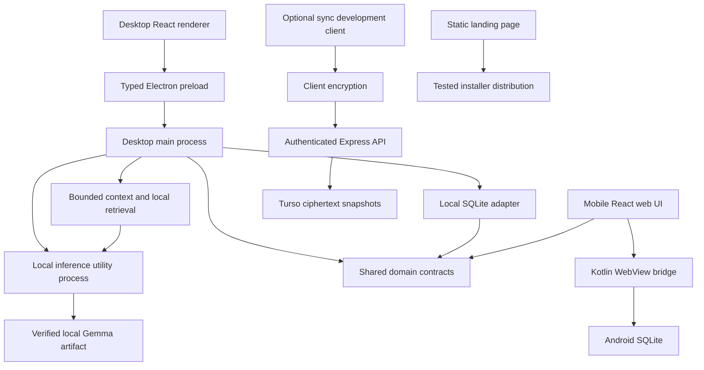
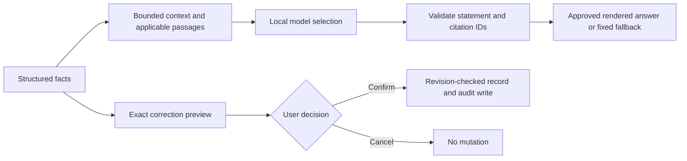

# Petal architecture and code organization

This guide describes the current repository, its runtime boundaries, and how to extend it. It is a map and coding guide, not proof that every platform acceptance check passed.

[PRD.md](PRD.md) owns product scope. [TASKS.md](TASKS.md) owns the fixed work breakdown. [AGENTS.md](AGENTS.md) owns task assignment, allowed paths, collaboration and verification. [docs/decisions.md](docs/decisions.md) records approved decisions; later decisions supersede earlier notes. [DESIGN.md](DESIGN.md) owns approved visual identity. Live progress belongs on the [GitHub Project](https://github.com/orgs/DheKode/projects/1).

## 1. System overview

Petal is a local-first pill companion. Shared TypeScript describes durable records and validation; platform adapters own storage and inference. UI code presents records and proposals. Optional cloud sync is separate and does not gate local use.



The Android APK currently hosts the web UI in Kotlin/WebView. The PRD's React Native/native direction and the separate React Native inference spike must not be conflated with that implementation. This document does not approve a platform change or claim that Android generation is integrated.

### Authority boundaries

| Layer | Owns | Must not own |
| --- | --- | --- |
| Domain | Record identities, schemas, schedules, validation, evidence/backup contracts and reviewed rule outputs. | React, Electron, browser storage, credentials, remote inference. |
| Storage adapter | Persistence, revisions, audit, transactional confirmation and recovery. | Clinical decisions, generated facts, UI rendering. |
| App service | Validated orchestration, platform adapters, user-confirmed writes and derived state. | Invented history or bypassing confirmation. |
| UI | Presentation, input, preview, explicit confirmation/cancellation, accessible feedback. | Arbitrary SQL, privileged filesystem access or authoritative clinical rules. |
| Local AI | Bounded statement selection, clarification and explanations from supplied facts/passages. | Database writes, new clinical actions, fabricated citations or exact times. |
| Sync API | Authenticated owner-scoped ciphertext/revision storage. | Decryption keys, plaintext health records, clinical interpretation. |

## 2. Repository organization

```text
petal-mono/
├── apps/
│   ├── desktop/             Electron + React application
│   │   ├── src/main/        Services, SQLite wrapper, IPC and AI worker
│   │   ├── src/preload/     Restricted renderer-to-main bridge
│   │   ├── src/shared/      IPC channel names and platform request/result types
│   │   ├── src/renderer/    HTML entry and React UI under src/
│   │   ├── scripts/        Fictional demo seed and model packaging
│   │   ├── build/          Model license/notice packaging resources
│   │   └── test/           Service, SQLite, inference and integration tests
│   ├── mobile/
│   │   ├── src/            Mobile React application and service contracts
│   │   ├── preview/        Vite browser review and WebView web-bundle entry
│   │   ├── android/        Kotlin host, native SQLite bridge and Gradle project
│   │   └── test/           Mobile service/flow tests
│   ├── landing/
│   │   ├── src/            Static page composition, interactions and styling
│   │   ├── tooling/        HTML partial composition
│   │   ├── worker/         Download-serving Worker
│   │   ├── scripts/        Tested-build staging and publishing
│   │   └── test/           Release data, platform detection and partial tests
│   ├── sync-api/           Express authentication, configuration and snapshot API
│   ├── sync-demo/          React development sync client with fictional notes
│   └── inference-spike/
│       ├── node/           Isolated desktop model/runtime workspace
│       └── android/        Isolated React Native/llama.rn workspace
├── packages/
│   ├── domain/             @petal/domain: portable records, schedules and validation
│   ├── storage/            @petal/storage: Node/main-process SQLite adapter
│   └── encrypted-sync/     @petal/encrypted-sync: crypto and snapshot client
├── libs/
│   ├── ui/                 @petal/ui: shared appearance and UI building blocks
│   └── assets/
│       ├── brands/         Approved SVG/PNG logo variants and vector masters
│       ├── images/         Original illustration collection and provenance
│       └── fonts/          Bundled fonts, licenses and source records
├── docs/                   Decisions, contracts, storage, AI and setup references
├── scripts/                Repository maintenance and fictional AI evaluation
├── .github/workflows/      Repository CI
├── README.md               Product overview and runnable setup entry points
├── ARCHITECTURE.md         This architecture and coding guide
├── AGENTS.md               Shared contributor/agent instructions
├── CLAUDE.md               Imports shared agent instructions
├── PRD.md                  Authoritative product requirements
├── TASKS.md                Fixed task plan and scope fence
└── DESIGN.md               Approved identity and design study
```

The root workspace includes `apps/*`, `packages/*` and `libs/*`. The deeper inference spikes have separate nested workspaces/lockfiles. Generated `dist/`, desktop `out/` and `release/`, mobile release files, local databases and model caches are not source folders and must not be committed.

## 3. Shared package boundaries

### Domain: `packages/domain`

[Source](packages/domain/src) is organized into `schemas.ts`, `schedule.ts`, `backup.ts`, `guidance.ts` and `evidence.ts`, exported through `src/index.ts`. Generated interchange schemas live in `schemas/`; approved reference data lives in `evidence/`.

- Portable production code uses TypeScript and Zod, without platform/framework imports.
- Build produces compiled ESM and declarations in `dist/`; consumers import `@petal/domain`, not a relative alias to its source.
- Runtime validation includes graph/identity checks, not just shape checks. Backup parsing preserves version, time-zone context, durable records and audit data.
- `ScheduledDose` identity is separate from actual intake date. `applyIntake` handles canonical events/corrections; storage writes their audit entries.
- Absence is `no-entry`; explicit alternatives include `taken`, `confirmed-missed` and `unsure`. Never turn a blank or approximate record into a confirmed fact.
- Guidance is currently an unsupported contract stub. The approved clinical corpus is empty. Data or an import claiming verification does not activate clinical rules.

See [domain contracts](docs/domain-contracts.md) for entity schemas, dose/time behavior, supported-profile constraints and backup validation.

### Storage: `packages/storage`

The Node/main-process adapter uses `@libsql/client` with an absolute local database path. It is not an Android driver and must not enter a renderer/browser bundle.

The current implementation stores a complete validated backup snapshot plus revision in `petal_state`, and pre-replacement recovery snapshots in `petal_recovery`. It does not have an indexed per-entity query schema. SQLite storage and JSON exports are plaintext.

Previews stage immutable proposed writes without mutating durable data. Tokens are local, revision-bound, single-use and time-limited. Confirmation rechecks the revision and commits the proposed change with its audit trail. Imports validate before preview, then keep recovery data and replace transactionally. Failed/cancelled/stale operations must preserve current data. Derived guidance is recomputed, not stored as authoritative output.

See [storage contract](docs/storage.md). The existing implementation resides in `src/index.ts`; this is a legacy layout exception, not the pattern for new package modules. A move requires an assigned storage-owner refactor, not an incidental cleanup.

### Encrypted sync: `packages/encrypted-sync`

Client encryption and snapshot transport are shared independently of UI. Web Crypto AES-256-GCM uses a user-held recovery key, fresh IVs and authenticated account/revision metadata. Conflicts require explicit review; there is no automatic record merge.

Native applications need verified crypto/secure-key adapters before integration can be claimed. The current demonstration operates on fictional notes, not a connected native health database. See [encrypted sync](docs/encrypted-sync.md).

### UI: `libs/ui`

```text
libs/ui/
├── index.ts                Framework-free package barrel
├── package.json            Public exports and optional platform peers
├── src/
│   ├── themes/             Canonical tokens, generators and generated exports
│   ├── components/         Shared controls and platform-neutral props
│   ├── hooks/              Shared UI behavior and platform adapters
│   ├── layouts/            Shared Screen/Stack layout primitives
│   ├── utils/              Pure presentation helpers
│   ├── icons/              Catalog, web/native renderers and notices
│   └── styles/             Shared web styles and local font registration
├── examples/web/           Component/icon review app
├── scripts/                Packaging and review-server tooling
└── test/                   Exports, platform contracts and shared UI checks
```

The package barrel is **`libs/ui/index.ts`**, not `src/index.ts`. Public imports include `@petal/ui/theme`, `theme/native`, `theme.css`, `fonts.css`, `styles.css`, `components`, `hooks`, `layouts`, `utils` and `icons`. Components/hooks/layouts/icons select native implementations through the `react-native` export condition; explicit `/native` subpaths are also available. Theme/pure imports do not require React or React Native.

`src/themes/petal.tokens.json` is canonical. Build scripts generate CSS and typed web/native exports plus `libs/ui/preview.html`. Edit source/generators, not generated files. Consuming apps declare `@petal/ui: workspace:*`, build its public exports and supply the platform dependencies they actually use.

## 4. Application organization and runtimes

### Desktop

| Location | Responsibility |
| --- | --- |
| [`src/main/index.ts`](apps/desktop/src/main/index.ts) | Application lifecycle, window/security policy, single-instance handling and IPC registration. |
| [`src/main/service.ts`](apps/desktop/src/main/service.ts) | Serialized application operations and validated domain/storage orchestration. |
| [`src/main/sqliteStore.ts`](apps/desktop/src/main/sqliteStore.ts) | Platform wrapper over `@petal/storage`. |
| [`src/main/aiService.ts`](apps/desktop/src/main/aiService.ts) | Bounded conversations, context, correction proposals and safe response selection. |
| [`src/main/aiRuntime.ts`](apps/desktop/src/main/aiRuntime.ts) | Model selection/verification, worker lifecycle, cancellation and failure handling. |
| [`src/main/aiWorker.ts`](apps/desktop/src/main/aiWorker.ts) | Local native inference in an Electron utility process. |
| [`src/main/aiArtifact.ts`](apps/desktop/src/main/aiArtifact.ts) | Exact Gemma size and SHA-256 verification. |
| [`src/preload/index.ts`](apps/desktop/src/preload/index.ts) | Exposes the narrow `window.petal` bridge; no arbitrary IPC or file/SQL access. |
| [`src/shared`](apps/desktop/src/shared) | Platform IPC constants, requests, discriminated results and AI/setup contracts. |
| [`src/renderer/src`](apps/desktop/src/renderer/src) | React screens/components, UI hooks, artwork references and app styling. |

The renderer is sandboxed, with context isolation and no Node integration. Requests must be validated again in the privileged service even if the UI typed/validated them. Native drivers remain outside the bundle/asar where required by packaging.

Desktop uses Electron + React through electron-vite; electron-builder creates platform output. Shared storage/domain/UI build first. The selected Gemma 3 Q4_K_M artifact is a verified build input outside Git and is bundled as a packaged resource outside the asar under the later model-delivery decision. Missing/corrupt weights must fail packaging or fall back safely at runtime. Never interpret bundling as permission to commit the GGUF.

### Mobile

`src/MobileApp.tsx` composes the application. `src/screens/` contains setup, today, pack, clarification, bleeding and settings experiences. `src/components/` holds application-specific controls; `src/services/` contains storage/AI orchestration; `src/types/` holds app-local types; `src/assets/` contains platform artwork copies already used by the build.

`preview/main.tsx` mounts the React web UI and optional browser phone frame. The Android Gradle application loads those web assets through Kotlin `MainActivity`, `WebViewAssetLoader` and `PetalNativeBridge`. `PetalDatabaseHelper` owns Android SQLite snapshots/recovery. The web service also persists a localStorage snapshot. Do not substitute `@petal/storage` for this Android driver.

A React Native dependency or native UI export does not prove that the installed app uses Metro/native rendering. The standalone `apps/inference-spike/android` workspace tests that separate direction. The integrated mobile AI service currently has an engine interface without a wired generator; hardcoded model/ready labels are not runtime evidence. Native reminder, import and inference claims need actual-device checks.

### Landing

```text
apps/landing/src/
├── main.ts                 Registers artwork and small DOM interactions
├── pages/                  Page-level HTML composition
├── layouts/                Site shell and document landmarks
├── components/             Section partials and download-card rendering
├── hooks/                  Download initialization and history-demo listeners
├── data/                   Fictional walkthrough content
├── utils/                  DOM, asset and static-icon helpers
├── styles/
│   ├── index.css           Style entry point
│   ├── base.css            Element/reset defaults
│   ├── layout.css          Shared page widths and section layout
│   ├── components/         Navigation, buttons and footer
│   ├── pages/              Home-specific compositions
│   └── responsive.css      Breakpoints and reduced-motion overrides
└── downloads.ts            Tested-build metadata and platform detection
```

Keep page structure in HTML partials, side effects in hooks and presentation in CSS. Teardown listeners on hot reload when applicable. Import shared fonts/theme values; do not install a second UI framework or duplicate raw tokens for this page. The fictional history walkthrough writes no personal records.

Only published/tested release metadata enables a download. Worker deployment replaces all assets, so publishing must preserve existing verified build files; follow [landing publishing instructions](apps/landing/AGENTS.md), not a bare deploy command.

### Sync API and demo

The API's `src/server.ts` owns startup; `config.ts` reads server-only configuration; `auth.ts` verifies Clerk identity; `app.ts` defines middleware/routes; `store.ts` owns owner-scoped persistence; `migrate.ts` applies the schema. Keep HTTP, authorization and persistence responsibilities separate.

`GET /health` reports process availability. Authenticated `/v1/snapshot` GET/PUT/DELETE use verified bearer identity and revision-based concurrency. PUT/DELETE require `If-Match`; stale writes return a conflict. Deletion keeps a tombstone revision. Turso stores ciphertext and metadata, not the client recovery key. The sync demo supplies consent, fictional data and recovery-key UI; it is not a production native adapter.

## 5. Core flows

### Record or correct intake

1. UI identifies the scheduled dose and the user's chosen state/time precision.
2. The app service validates the request and applies domain rules.
3. Storage stages the exact proposed current event and prior value.
4. A direct logging action can provide the user's confirmation; a chat-proposed write requires a separate visible preview and explicit confirm.
5. A serialized/revision-checked transaction writes the record and audit entry.
6. The app refreshes structured state and recomputes supported derived results.

Never choose a dose merely from the actual calendar date, rewrite historical offsets when the usual time changes, or infer a confirmed miss from no entry. Corrections preserve identity and provenance. Undo is a new audited mutation, not erasure of the previous event history.

### History repair and explanations



The model has no direct write tool. Preview/confirm/cancel and stale-record protection belong to application/storage services. Desktop conversations are transient; personal records and audits are durable. Context selects relevant records and a small number of applicable passages rather than uploading the whole journal. Readable references resolve by stored IDs. Missing evidence or generation failure must preserve useful tracking and clear limits.

### Backup/import

Export serializes complete durable records, settings and audit history with schema/app version and a plaintext sensitivity notice. Import must validate size/schema/IDs/dates/references/product compatibility before preview. After explicit replacement confirmation, create recovery data and replace within one transaction; cancel/failure changes nothing. Do not silently merge snapshots or import credentials, encryption keys or derived clinical output as facts.

### Optional sync

Opt-in client → encrypt snapshot locally → authenticated API → owner-scoped ciphertext revision. Read/decrypt/review before replacement. Keys remain unavailable to the backend. Account switching must isolate consent, key state and in-flight operations. Sync is not a dependency of logging or local AI.

## 6. How we write code

### Pick the correct home

| Change | Put it here |
| --- | --- |
| Cross-platform record rule, schema or schedule behavior | A focused module in `packages/domain/src/`. |
| Node/desktop SQLite behavior | `packages/storage`, coordinated with the storage owner. |
| OS, filesystem, database or native inference integration | The application's privileged platform service/adapter. |
| Reusable presentation/control behavior across apps | The appropriate `libs/ui/src/` folder and public export. |
| Screen composition or app-specific hook/style | The existing application folder; do not force a shared component prematurely. |
| Approved identity/illustration/font assets | `libs/assets/brands`, `images` or `fonts`, with provenance and usage notes. |
| Interface agreement, source review or measured result | `docs/` or the assigned evaluation documentation. |
| Reusable maintenance/benchmark task | `scripts/` or app-local `scripts/`, matching its scope. |

Do not create a new package, alias root, competing `lib/` folder, or blanket reorganization as part of an unrelated change. Desktop currently keeps screens/components/hooks together under `src/renderer/src`; mobile and landing have explicit subfolders. Preserve each application's existing structure until an owner assigns a refactor.

### Types, validation and imports

- Use strict TypeScript and the existing base/package compiler configurations. Prefer explicit types at public boundaries and discriminated results for expected failures.
- Use `import type` for type-only dependencies. Treat untrusted IPC, JSON, HTTP and model outputs as unknown until runtime validation succeeds. A cast is not validation.
- Use `@petal/*` public package exports between workspaces. Declare the dependency in the consuming manifest and coordinate lockfile/config changes.
- Compiled NodeNext/ESM package imports and exports use emitted `.js` specifiers; follow the app's existing bundler conventions for app-local imports. Do not bulk-normalize extensions/styles across unrelated files.
- Package barrels contain one `export * from './module.js';` line per module, appended for new exports; implementation belongs in the module. `@petal/storage`'s existing implementation barrel is the documented legacy exception.
- Keep platform-only dependencies behind their adapters/conditional entry points. Pure utilities and tokens must not unexpectedly load React, Electron or native modules.
- Pin approved dependencies. Do not add a library or regenerate root configuration just to solve a small local styling/helper problem.

### Names and module shape

Use PascalCase for React component/type names; camelCase for functions, variables, hooks and focused helpers; uppercase names for existing exported constant/channel patterns. Hooks begin with `use` when they follow React hook semantics; imperative landing initializers can retain `initialize`/`bind` names. Native Android files follow their Kotlin class names. Preserve the existing convention around a touched file.

Keep functions focused on one responsibility. Put effects at the platform boundary or in lifecycle-managed hooks. Prefer pure derivation for state/math and explicit inputs for dates/time zones. Do not introduce global persistence, network access or mutations inside a display component. Comments explain constraints and decisions, not a line-by-line translation of the code. Avoid broad reformatting or unrelated cleanup.

### UI, styles and accessibility

Use approved Geist Sans, original logo outlines, semantic token colors/sizes/spacing/radii and shared component contracts. Shared custom styles belong under `libs/ui/src/styles`; app-specific layout belongs in the app. Regenerate theme output from its source when changing a token; do not hand-edit generated exports.

Controls need explicit labels, keyboard/focus behavior, adequate targets and readable scaling. Record states use text as well as color/icons; no checkmark implies protection. Decorative art is hidden from assistive technology and keeps its aspect ratio. Motion respects reduced-motion settings, stays restrained and does not gate information. Separate platform rendering/TalkBack checks from mocked/type-level tests.

### Errors, privacy and concurrency

Return stable bounded errors without including records, user-entered notes, tokens, keys or raw database/model payloads. Do not suppress a persistence failure and silently pretend a write succeeded. Fixed fallbacks must honestly identify limits, not fabricate evidence or generation.

Keep privileged operations serialized or revision-checked. Confirm exactly the proposal shown; reject stale/replayed/cancelled tokens. A UI click and a TypeScript type alone are not authorization at the platform boundary. Keep server credentials out of apps and client recovery keys out of the server. Local plaintext storage must stay disclosed.

### Tests and fixtures

Use the existing package runners (`node:test` through Node or tsx where configured). Prefer behavior fixtures over assertions that mirror the implementation. Use fictional records and temporary storage, never real health data.

Test the changed risks: dose/time identity, uncertainty, corrections/audit, stale previews, cancellation, failed transactions, malformed imports, model/citation failure, auth isolation or platform adapter behavior. A mock establishes the contract being exercised, not device/runtime acceptance. Purely cosmetic reversible changes can use targeted layout/keyboard checks without inventing redundant tests.

## 7. Build, packaging and verification

Node 22+ and pinned pnpm are required. See [README setup](README.md#getting-started) for runnable commands. Packages that expose compiled artifacts must build before consumption. Root CI runs install/typecheck/test/build; use scoped package checks while developing and follow the required push gates in AGENTS.md unless the human explicitly narrows them.

| Artifact | Source / command family | Boundary |
| --- | --- | --- |
| Domain/UI exports | Package build scripts | Generated `dist/`; canonical sources remain versioned. |
| Token preview/exports | `node libs/ui/src/themes/scripts/build.mjs` | Generated together; `--check` verifies consistency. |
| Desktop bundles/installers | electron-vite / electron-builder package scripts | Build on target OS; native drivers and exact GGUF verified; no generated installers in Git. |
| Android APK | Vite web bundle + Gradle host | Current Unix-shell build script and debug-key signing need clear disclosure. |
| Landing distribution | Tested-build `publish-build` workflow | Preserve/reverify published files; no untested release URLs. |
| Optional sync | API configuration/migration + demo build | Separate credentials/TLS/native-key integration requirements. |

Builds, tests and benchmarks must say exactly what ran. The compiled native module, installed app, actual device and disconnected end-to-end flow require separate evidence. Do not claim phone performance from a desktop spike or model correctness from valid JSON selection.

## 8. Known implementation boundaries

| Area | Current boundary / next required agreement |
| --- | --- |
| Clinical guidance | Shared engine remains unsupported and approved clinical corpus is empty; reviewed formulation, source-backed branches and fixtures must precede activation. |
| Android architecture | WebView implementation exists alongside the PRD/native direction; platform owners must explicitly reconcile it. Documentation is not approval of a stack change. |
| Mobile inference | Engine interface is unwired; hardcoded Gemma 4/ready labels differ from approved Gemma 3. Generation and model identity require integration and device evidence. |
| Mobile clinical templates | Hardcoded source/product/guidance claims do not establish shared evidence review; reconcile before claiming supported clinical behavior. |
| Persistence/privacy | Desktop SQLite, Android SQLite and browser localStorage are not encrypted at rest; native import/reminder guarantees need platform checks. |
| Optional sync | Development snapshot tool exists; native health-record integration and secure-key lifecycle are not complete. |
| Models/packaging | Later decision bundles Gemma on desktop; old unbundled-only documentation must not override that decision. Windows/Android acceptance remains separate. |
| Existing layout exceptions | Storage implementation in its index and flat desktop renderer are preserved until an assigned refactor. Do not copy them as new shared-package patterns. |

These are engineering boundaries, not a live task status board. Record fixes, owners, evidence and remaining work on the linked issues.

## 9. Keeping this guide accurate

When an approved change moves a folder, adds a public interface, changes a runtime or alters confirmation/storage/security behavior, update this guide and the relevant detailed contract in the same assigned task. Record the agreement in `docs/decisions.md` without rewriting historical sections. Keep README focused on setup/product entry points; keep AGENTS focused on mandatory workflow and references to this guide.

Do not use this document to silently expand product scope, activate clinical rules, bypass user confirmation or override human ownership.
